# Flow Matching ハンズオン

Flow Matching を、小さい例から段階的に動かして理解するためのコード置き場。

| 段階 | 内容 | スクリプト |
|---|---|---|
| 1 | 2次元のおもちゃデータで、Flow Matching の本質(学習と生成)を見る | [stage1_2d_toy.py](stage1_2d_toy.py) |
| 2 | MNIST で条件付き生成と CFG | [stage2_mnist_cfg.py](stage2_mnist_cfg.py) |
| 3 | 音声 Mel で、参照 Mel を先頭に置いた生成 | [stage3_audio_prompt.py](stage3_audio_prompt.py) |

---

# 段階1：2次元のおもちゃデータ

## 実行方法

必要なパッケージ：torch、numpy、matplotlib、scikit-learn、Pillow(GIF保存用)

```bash
python stage1_2d_toy.py                 # 二つの三日月(moons)
python stage1_2d_toy.py --data 8gauss   # 円周上に並んだ8個のガウス分布
```

CPU(4スレッド)で 5000 step の学習が 10〜15 秒、作図を含めて全体で 20 秒前後。
結果は `outputs/stage1_<data>/` に保存される。

## 1. Flow Matching は何をしているか

やりたいことは「簡単に作れる分布(標準正規ノイズ)」から「データの分布」への変換を学ぶこと。
Flow Matching では、この変換を **点を少しずつ動かす流れ** として表す。

- 時刻 `t` は 0 から 1 まで動く。`t=0` がノイズ、`t=1` がデータ。
- 各位置 `x`・各時刻 `t` で「点がどちら向きにどれだけの速さで動くか」を返す関数 `v(x, t)` を NN で表す。これを **速度場** と呼ぶ。
- 生成するときは、ノイズの点を速度場に沿って `t=0` から `t=1` まで動かす。すると点がデータの分布に着く。

つまり学習するのは「生成画像そのもの」ではなく「各時刻・各位置での移動方向」。

### 学習：直線の方向を当てるだけ

問題は、正しい速度場 `v(x, t)` を誰も知らないこと。Flow Matching は次のように学習の正解を作る。

1. データ `x1` を 1 つ取る。
2. ノイズ `x0 ~ N(0, I)` を 1 つ取る(`x1` とは無関係に、ランダムにペアにする)。
3. 時刻 `t ~ U(0, 1)` を取る。
4. `x0` と `x1` を結ぶ直線上の点 `xt = (1 - t) * x0 + t * x1` を作る。
5. この直線に沿って `t` で動く点の速度は `d(xt)/dt = x1 - x0`(`t` によらず一定)。
6. NN に `xt` と `t` を入れ、出力が `x1 - x0` に近づくよう二乗誤差で学習する。

コードではこれがそのまま [stage1_2d_toy.py](stage1_2d_toy.py) の `flow_matching_loss` になっている。

```python
x0 = torch.randn_like(x1)                # ノイズ(始点)
t = torch.rand(x1.shape[0], 1)           # 時刻 t ~ U(0,1)
xt = (1 - t) * x0 + t * x1               # 始点と終点を結ぶ直線上の点
target_v = x1 - x0                       # その直線の速度(tによらず一定)
return ((model(xt, t) - target_v) ** 2).mean()
```

### なぜこれで正しい速度場が学べるのか

同じ位置 `xt` と時刻 `t` を通る直線は、ランダムペアなので何本もある(図1右で線が交差している)。
NN は同じ入力に対して 1 つの値しか返せないので、二乗誤差を最小にする出力は
「その位置・時刻を通る全ての直線の速度の **平均**」になる。

この「平均の速度場」に沿って点を動かすと、各時刻での点の分布が、学習で作った `xt` の分布と一致することが知られている
(Lipman et al. 2023 "Flow Matching for Generative Modeling" の主結果)。
`t=1` での `xt` の分布はデータそのものなので、終点の分布もデータの分布になる。
図3はこれを実際に確かめている。

### 生成：速度場を積分する(Euler 法)

`dx/dt = v(x, t)` を `t=0` から `t=1` まで数値積分する。最も単純な Euler 法は

```
x ← x + v(x, t) * dt     (dt = 1 / ステップ数)
```

を繰り返すだけ。コードの `euler_sample` がこれ。

## 2. 結果の図と見どころ

以下は moons の図。8gauss も同じファイル名で `outputs/stage1_8gauss/` にある。
下の数値は、同じ設定(seed=0, 5000 step)でもう一度学習したモデルで計算したもの。
図を作った実行とは乱数の消費順が違うので、図とは少しだけずれる。

### 図1：学習で使うペア — [fig1_training_pairs.jpg](outputs/stage1_moons/fig1_training_pairs.jpg)

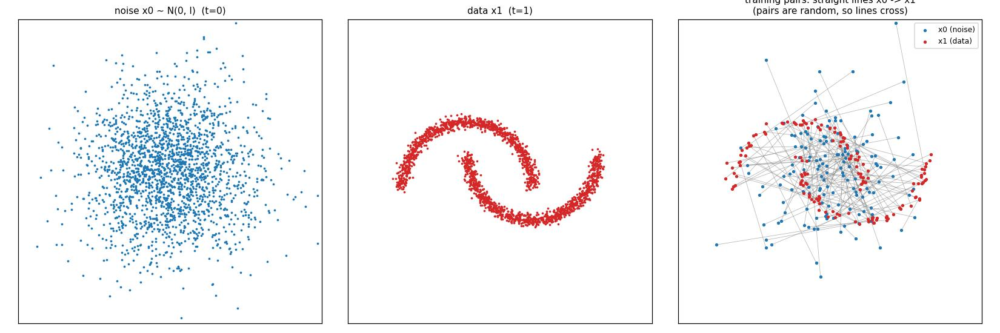

- 左：ノイズ `x0`、中：データ `x1`、右：ランダムに作ったペアを結ぶ直線。
- 右の直線は互いに交差している。学習の正解はこの「交差する直線の速度」で、NN はその平均を学ぶ。

### 図2：損失の推移 — [fig2_loss.jpg](outputs/stage1_moons/fig2_loss.jpg)

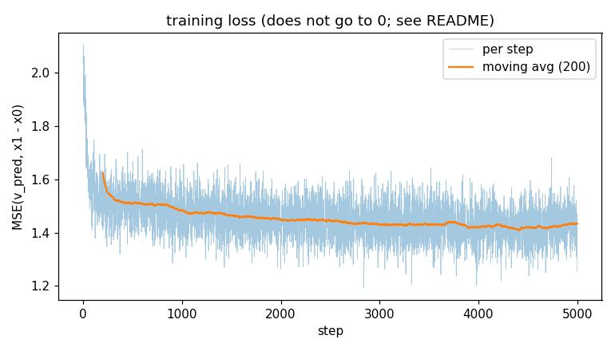

損失は 0 にならず、moons では 1.4 付近で止まる。これは学習の失敗ではなく、上で書いた
「同じ入力に複数の正解がある」ことによる、どうやっても消せない誤差。

時刻ごとに損失を測ると、両端で理論値と一致していた(誤差は2次元の平均):

| | t=0 の損失 | 理論値(t=0) | t=1 の損失 | 理論値(t=1) |
|---|---|---|---|---|
| moons | 1.128 | 1.124 | 1.126 | 1.0 |
| 8gauss | 3.180 | 3.148 | 1.271 | 1.0 |

- `t=0` では `xt = x0` で、`x1` について何も分からない。最適な出力は `E[x1] - x0` になり、残る誤差は **データの分散**(各次元の平均。moons で 2.248/2 = 1.124)。
- `t=1` では `xt = x1` で、`x0` について何も分からない。残る誤差は **ノイズの分散** = 1。
- 損失の値そのものは「どれだけ良く学べたか」の指標として使いにくい、ということ。

### 図3：学習で作った分布と、生成の途中状態の比較 — [fig3_marginal_vs_generated.jpg](outputs/stage1_moons/fig3_marginal_vs_generated.jpg)

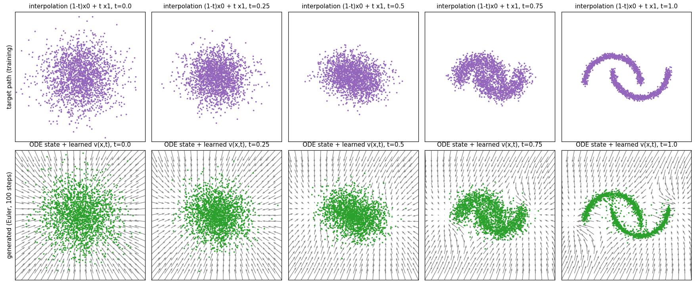

- 上段：学習の式 `(1-t)x0 + t x1` で直接作った点の分布(学習が目指す流れ)。
- 下段：ノイズから始めて、学習した速度場で `t` まで積分した点(緑)と、その時刻の速度場(灰色の矢印)。
- 各 `t` で上段と下段の分布が一致していれば、速度場が「分布の流れ」を正しく学べている。
- 矢印の向きと大きさが `t` によって変わる点にも注目。`t=0` での最適な速度は `E[x1] - x0`、つまりどこにいてもデータの平均に向かう向き(次の図4の 1 step の結果につながる)。

### 図4：Euler のステップ数を変えたときの生成結果 — [fig4_euler_steps.jpg](outputs/stage1_moons/fig4_euler_steps.jpg)

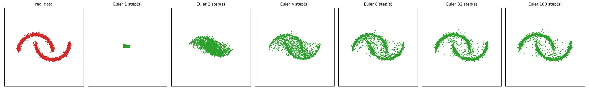

同じ初期ノイズから、ステップ数だけ変えて生成した。生成の質を2つの数値で測った:

- 生成点→実データ：各生成点から一番近い実データまでの距離の平均(小さいほど、変な場所に点を作っていない)
- 実データ→生成点：各実データから一番近い生成点までの距離の平均(小さいほど、データの全域をカバーしている)

| ステップ数 | moons 生成点→実データ | moons 実データ→生成点 | 8gauss 生成点→実データ | 8gauss 実データ→生成点 |
|---|---|---|---|---|
| 1 | 0.424 | 1.122 | 1.877 | 1.750 |
| 2 | 0.161 | 0.184 | 0.470 | 0.188 |
| 4 | 0.061 | 0.048 | 0.085 | 0.050 |
| 8 | 0.036 | 0.027 | 0.042 | 0.031 |
| 32 | 0.025 | 0.023 | 0.024 | 0.026 |
| 100 | 0.022 | 0.022 | 0.021 | 0.026 |

- **1 step では全点がデータの平均付近の1か所に潰れる**。生成点の標準偏差は moons で (0.07, 0.05)、8gauss で (0.15, 0.18) しかない。
  理由：`t=0` の最適な速度は上で書いた `E[x1] - x0` なので、`x0 + (E[x1] - x0) * 1 = E[x1]` となり、どのノイズから始めても平均に着く。
- 4〜8 step でかなり良くなり、32 step 以降はほぼ変わらない。
- IndexTTS2.5 の s2mel も Euler 法で、ステップ数は `n_timesteps` で指定する([flow.py](../survey/IndexTTS2.5/models/s2mel/flow.py) の `t_span = torch.linspace(0, 1, n_timesteps + 1)`)。
  音声でステップ数を減らすと品質が落ちるのも、ここで見ているのと同じ理由。

### 図5：学習の直線と、実際の生成の軌跡 — [fig5_trajectories.jpg](outputs/stage1_moons/fig5_trajectories.jpg)

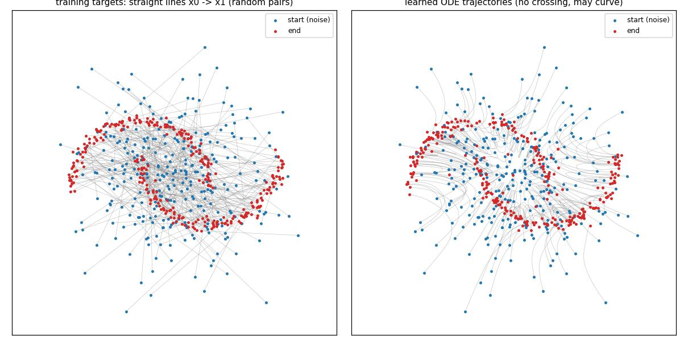

- 左：学習の正解に使った直線(ランダムペアなので交差し、遠くまで移動する)。
- 右：学習した速度場で積分した実際の軌跡。
  - **軌跡は交差しない**。速度場は各位置・時刻で1つの向きしか持たないので、2本の軌跡が同じ場所・同じ時刻を通ることはない。
  - その代わり **軌跡は曲がる**。100 step で積分した軌跡の長さを、始点から終点までの直線距離で割ると、中央値で moons 1.71、8gauss 1.24 だった(1.0 なら完全な直線)。
  - 移動距離は短い。始点→終点の距離の平均は、moons で学習のランダムペア 1.83 に対して生成の軌跡は 0.56、8gauss で 2.70 に対して 1.31。各ノイズ点は、ランダムな相手ではなく近くのデータに運ばれている。
- 軌跡が曲がっているほど、少ないステップの Euler 法では曲がりを追えずに誤差が出る(図4の 1〜2 step が悪い理由)。
  この曲がりを減らして少ステップで生成できるようにするのが、Rectified Flow(学習した流れで作ったペアで学び直す)や
  OT-CFM(ミニバッチ内で近いもの同士をペアにする)といった後続手法の動機。

### アニメーション — [flow.gif](outputs/stage1_moons/flow.gif)

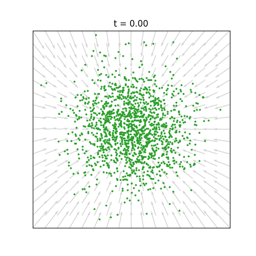

ノイズの点(緑)が速度場(灰色の矢印)に沿ってデータへ流れていく様子。矢印が時刻とともに変化するのが分かる。

## 3. IndexTTS2.5 の s2mel との対応

[survey/IndexTTS2.5/models/s2mel/flow.py](../survey/IndexTTS2.5/models/s2mel/flow.py) と比べると、本質の部分は同じ。

| 項目 | 段階1(このコード) | IndexTTS2.5 s2mel |
|---|---|---|
| 生成対象 | 2次元の点 `[B, 2]` | Mel `[B, F, T]` |
| 時刻の向き | `t=0` ノイズ、`t=1` データ | 同じ |
| `t` の取り方 | `U(0, 1)` | 同じ(`torch.rand`) |
| 補間 | `(1 - t) x0 + t x1` | `(1 - (1 - σ_min) t) z + t x1`、`σ_min = 1e-6` |
| 正解の速度 | `x1 - x0` | `x1 - (1 - σ_min) z` |
| 速度を出すNN | MLP、`t` はそのまま入力に連結 | DiT、`t` は `TimestepEmbedder` で埋め込む |
| 条件 | なし | semantic 条件 `mu`、話者 `style`、参照 Mel `prompt` |
| 損失の範囲 | 全体 | 参照 Mel の区間を除いた部分だけ |
| 生成 | Euler 法 | Euler 法 + CFG |

- `σ_min = 1e-6` は `t=1` のときにほんの少しノイズを残すための項で、値が極めて小さいので、実質このコードと同じ式。
- 条件・参照 Mel・CFG は段階2・3で追加する。

## 4. 自分で試すと理解が深まること

- `--data 8gauss` で同じ図を見る。8つの山に分かれる分布で、1 step の平均への潰れや軌跡の曲がりがより分かりやすい。
- `flow_matching_loss` の `t = torch.rand(...)` を `t = torch.rand(...) * 0.5`(`t` を前半だけにする)に変えて、図3の後半がどう崩れるか見る。
- `--steps 500` など学習を短くして、図3の上段と下段のずれ方を見る。
- `euler_sample` を2次の方法(Heun 法：仮に1歩進めた先の速度と今の速度を平均して進む)に変え、少ないステップでの結果が図4からどれだけ良くなるか比べる。

---

# 段階2：MNIST で条件付き生成と CFG

## 実行方法

必要なパッケージ：段階1のもの + torchvision、diffusers。GPU を使う。

```bash
python stage2_mnist_cfg.py
```

- MNIST は初回に `data/` へ自動でダウンロードされる。
- 学習は batch 64 × 10 epoch。学習中の別プロセスと GPU を共有した状態で約11分(1 epoch 約67秒)、評価と作図で約2.5分かかった。
- 学習時の VRAM のピークは 1.4GB 程度。評価は 125 枚ずつ生成する(CFG で条件あり・なしを結合しても、NN に一度に通すのは 250 枚)。
- 結果は `outputs/stage2_mnist/` に保存される。評価値は `metrics.json` に入る。

## 段階1からの差分

| 項目 | 段階1 | 段階2 |
|---|---|---|
| データ | 2次元の点 | MNIST 画像 `[1, 28, 28]`(画素を [-1, 1] に変換) |
| 速度を出す NN | MLP | diffusers の `UNet2DModel`(6.5M パラメータ) |
| `t` の渡し方 | 入力に連結 | U-Net の時刻埋め込みに `t * 1000` を渡す |
| 条件 | なし | 数字ラベル(クラス埋め込みとして時刻埋め込みに足される) |
| 学習 | 段階1の損失 | 同じ損失。ただし確率 10% でラベルを「条件なし」用のラベル 10 に置き換える |
| 生成 | Euler 法 | Euler 法 + CFG |

学習の損失は段階1とまったく同じ式で、NN にラベルを追加で渡しているだけ。

## 1. 条件付き生成

ラベル `c` を NN に渡すと、NN が学ぶのは「その位置・時刻を通り、**ラベル `c` のデータへ向かう** 直線の速度の平均」になる。
平均を取る対象がラベル `c` のデータに限られるので、その速度場で積分すると、ラベル `c` の分布に着く。
理屈は段階1と同じで、「平均を取る範囲」が条件で絞られるだけ。

## 2. CFG(classifier-free guidance)

### 学習：1つの NN で「条件あり」と「条件なし」の両方を学ぶ

学習時、一定の確率(ここでは 10%)でラベルを「条件なし」を表す特別なラベルに置き換える。
すると同じ NN が、

- 本物のラベルを渡したとき：条件ありの速度 `v(x, t, c)`
- 条件なしのラベルを渡したとき：全データについての平均の速度 `v(x, t, なし)`

の両方を出せるようになる。条件なしの場合は、段階1と同じ「条件のない Flow Matching」になっている。

### 生成：条件あり・なしの差を強調する

```
v = (1 + w) * v(x, t, c) - w * v(x, t, なし)
  = v(x, t, c) + w * (v(x, t, c) - v(x, t, なし))
```

- `v(x, t, c) - v(x, t, なし)` は「ラベル `c` を指定したことで速度がどう変わったか」。これを `w` 倍して足す。
- `w = 0`：条件ありの速度そのまま(CFG なし)
- `w = -1`:条件なしの速度だけ(ラベルを無視)
- `w > 0`:ラベルらしさを強調する方向に外挿する

コードでは `cfg_velocity` で、条件ありと条件なしの入力を1つのバッチにまとめて NN に通している。

## 3. 評価の方法

- 各数字 100 枚、計 1000 枚を生成する。全ての条件で同じ初期ノイズを使う。
- **正解率**:別に学習した数字分類器(小さい CNN、2 epoch。テスト正解率 98.4%)で生成画像を分類し、指定した数字と一致した割合。
- **多様性**:同じ数字として生成した画像どうしの平均 L2 距離(画素は [-1, 1])を、数字ごとに計算して平均したもの。大きいほど、同じ数字の中でのばらつきが大きい。
  基準として、実データ(テストデータの各数字 100 枚)で同じ値を計算すると **17.53**。

## 4. 結果

### 図1：学習で使う x_t と正解の速度 — [fig1_training_path.jpg](outputs/stage2_mnist/fig1_training_path.jpg)

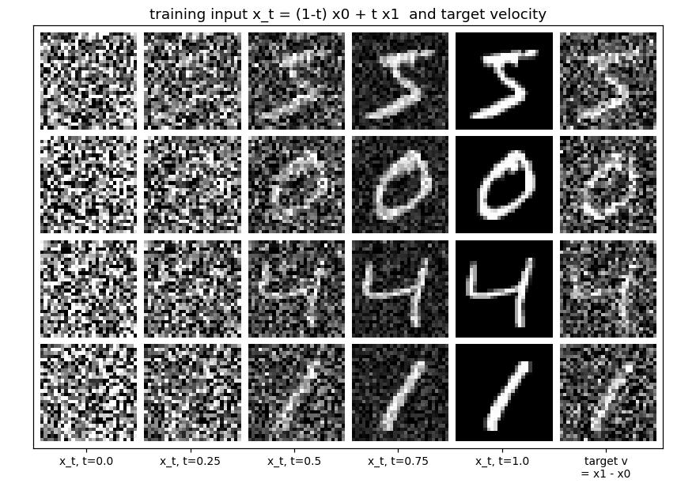

段階1の `(1-t) x0 + t x1` を画像に適用したもの。右端の列は正解の速度 `x1 - x0`(値域が広いので半分にして表示)。

### 図2：損失の推移 — [fig2_loss.jpg](outputs/stage2_mnist/fig2_loss.jpg)

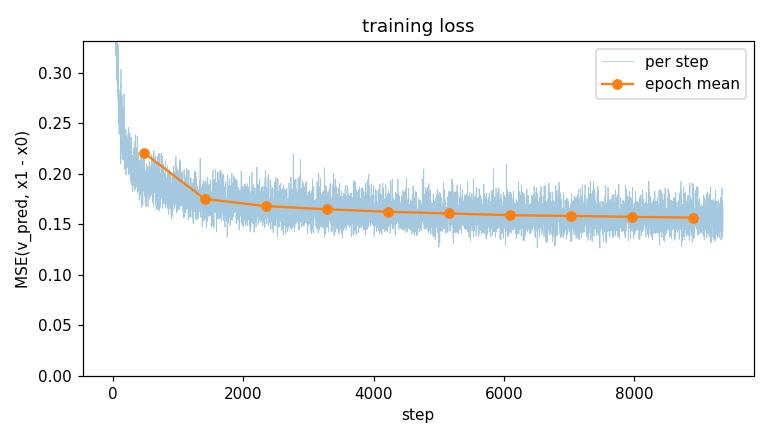

epoch ごとの平均は 0.221 → 0.175 → 0.168 → … → 0.157(10 epoch 目)。段階1と同じ理由で 0 にはならない。

### 図3:CFG の強さ — [fig3_cfg.jpg](outputs/stage2_mnist/fig3_cfg.jpg)

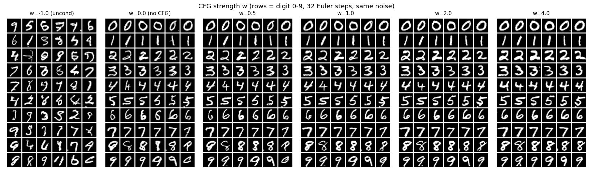

行が数字 0〜9 で、各パネルは同じ初期ノイズから `w` だけ変えて生成した(Euler 32 step)。

| w | 正解率 | 多様性(実データ 17.53) |
|---|---|---|
| -1(条件なし) | 0.115 | 19.86 |
| 0(CFG なし) | 0.954 | 17.66 |
| 0.5 | 0.998 | 17.17 |
| 1 | 1.000 | 16.80 |
| 2 | 1.000 | 16.28 |
| 4 | 1.000 | 15.48 |

- `w = -1` ではラベルを無視するので、正解率は偶然一致する 10% 前後になる。多様性が実データより大きいのは、同じ数字として集計した中に別の数字が混ざるため。
- `w = 0`(CFG なし)で正解率 95.4%、多様性 17.66 は実データの 17.53 とほぼ同じ。
- `w` を上げると正解率は 99.8%(w=0.5)、100%(w≥1)に上がる。一方で多様性は下がり続け、実データより小さくなっていく。
  これが CFG の「条件への忠実さ」と「多様性」のトレードオフ。

### 図4:Euler のステップ数 — [fig4_euler_steps.jpg](outputs/stage2_mnist/fig4_euler_steps.jpg)

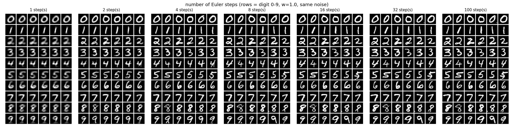

`w = 1` で固定し、同じ初期ノイズからステップ数だけ変えた。

| ステップ数 | 正解率 | 多様性 |
|---|---|---|
| 1 | 1.000 | 2.56 |
| 2 | 1.000 | 9.22 |
| 4 | 1.000 | 13.65 |
| 8 | 1.000 | 15.57 |
| 16 | 1.000 | 16.36 |
| 32 | 1.000 | 16.80 |
| 100 | 1.000 | 17.10 |

- **1 step では多様性が 2.56 しかない**(32 step では 16.80)。段階1と同じ理由で、初期ノイズによらずほぼ同じ画像になる。
  `t = 0` では最適な速度が「データの平均 − x0」になる。条件ありでは `E[x1 | c] - x0`、条件なしでは `E[x1] - x0`。
  これを CFG の式に入れて 1 step 進めると、
  `x0 + v = E[x1 | c] + w * (E[x1 | c] - E[x1])`
  となって `x0` が消え、どの初期ノイズからでも同じ画像(数字 `c` の平均画像を強調したもの)になる。
  理論上は多様性 0 で、実測の 2.56 は NN の誤差の分だけばらついている。
- 正解率は 1 step でも 100% だった。平均画像でも数字の形は残るので、分類器は当てられる。正解率だけ見ていると、この潰れには気づけない。
- ステップ数を増やすほど多様性が実データ(17.53)に近づく。

### 図5:生成の途中経過 — [fig5_generation_process.jpg](outputs/stage2_mnist/fig5_generation_process.jpg)

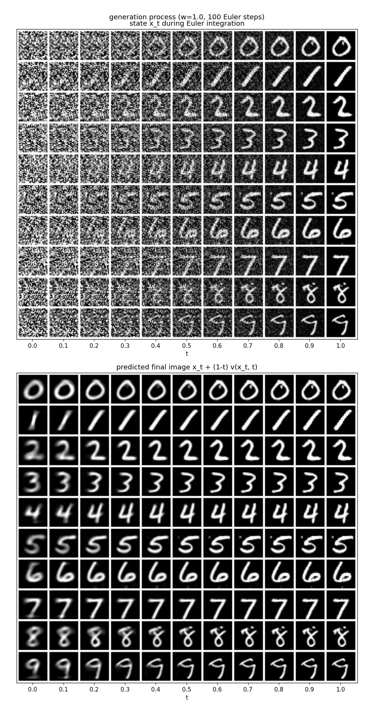

数字 0〜9 を 1 枚ずつ(`w = 1`、100 step)生成し、t = 0, 0.1, …, 1 の時点を並べた。

- 上:その時点の状態 `x_t`。
- 下:その時点の速度から推定した最終画像 `x_t + (1 - t) * v(x_t, t)`。
  `xt = (1-t)x0 + t x1` から `x1 - x0 = (x1 - xt) / (1-t)` なので、速度は `v = (E[x1 | xt] - xt) / (1-t)` と書ける。
  よって `xt + (1-t) v = E[x1 | xt]`、つまり「今の状態から見た最終画像の平均的な予想」になる。
  平均なので、`t` が小さく候補が多いうちはぼやけた画像になり、`t` が進んで候補が絞られるにつれてくっきりしていくはず。図で確認してほしい。

### アニメーション — [flow.gif](outputs/stage2_mnist/flow.gif)

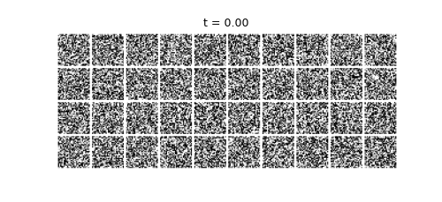

列が数字 0〜9、行がサンプル(各 4 枚)。ノイズから数字が形になっていく様子。

## 5. IndexTTS2.5 の s2mel との対応(CFG 部分)

| 項目 | 段階2 | IndexTTS2.5 s2mel |
|---|---|---|
| 条件 | 数字ラベル | 参照 Mel `prompt_x`、semantic 条件 `mu`、話者 `style` |
| 学習時に条件を落とす | サンプルごとに確率 10% でラベルを「条件なし」に | 確率 `class_dropout_prob` で、バッチ全体の条件(参照・semantic・話者)をまとめて 0 にする([dit.py](../survey/IndexTTS2.5/models/s2mel/dit.py) の `class_dropout`) |
| 推論時の条件なし | ラベル 10 | `prompt_x`・`style`・`mu` を 0 にした入力([flow.py](../survey/IndexTTS2.5/models/s2mel/flow.py) の `stacked_*`) |
| CFG の式 | `(1 + w) * v_cond - w * v_uncond` | 同じ(`inference_cfg_rate` が `w`) |
| 条件あり・なしの計算 | 1つのバッチに結合して1回で計算 | 同じ(バッチ軸で結合して `chunk(2)` で分ける) |

## 6. 自分で試すと理解が深まること

- `--p_uncond 0` で学習して `w > 0` の生成をする。「条件なし」のラベルの埋め込みが一度も学習されないので、CFG の結果がどうなるか見る。
- `w` をさらに大きく(8、16 など)して、画像がどう破綻するか見る。
- ステップ数の比較を `w = 0` でも行い、1 step の潰れ方が `w` によってどう変わるか見る(上の式では `w` が大きいほど平均画像が強調される)。

---

# 段階3：音声 Mel で、参照 Mel を先頭に置いた生成

TTS の「参照音声の声で、指定した内容を喋らせる」(ゼロショット音声クローン)を、数字1つの読み上げに縮めたもの。
**同じ話者が別の数字を読んだ音声を参照として渡し、その人の声で、指定した数字を読んだ Mel を生成する。**

## 実行方法

必要なパッケージ：段階2のもの + librosa、soundfile、torchaudio、transformers。GPU を使う。

```bash
# AudioMNIST(https://github.com/soerenab/AudioMNIST)の data/ 以下を data/AudioMNIST/data に置く
python stage3_audio_prompt.py
```

- **データ**:AudioMNIST。60人(男48・女12)が英語で数字 0〜9 を各50回読んだ 30,000 発話。48kHz、1発話 0.6 秒前後(最大 0.96 秒)。
  - 元の録音は音量が非常に小さい(ピークの中央値 −34 dBFS)。読み込み時に 16kHz へ変換し、ピーク 0.9 にそろえる。
  - 起動時に全 wav から log-Mel(80 bin、窓 1024、hop 256)を計算してメモリに置く。前処理ファイルは作らない。
- **話者の分け方**:学習用 50 人、学習に使わない評価用 10 人(男女比に合わせて男8・女2。話者番号 46, 48, 49, 50, 51, 53, 54, 55, 59, 60)。
- **時間**(RTX 5090):学習 30,000 step(batch 64)が 9.6 分、評価が 2.9 分。
  データ読み込みは、torch のスレッドを 4 に固定する前の実行で 13.5 分かかった(20 スレッドだと短い wav の resample が 1 ファイル 16.8ms、4 スレッドなら 0.8ms)。固定後は 1 分弱の見込み(全体ではまだ測っていない)。
- 結果は `outputs/stage3_audiomnist/` に保存される(図 4 枚、試聴用の音声 `audio/`、評価値 `metrics.json`)。

## 段階2からの差分

| 項目 | 段階2 | 段階3 |
|---|---|---|
| データ | MNIST 画像 | 同じ話者の 2 発話をつないだ log-Mel `[フレーム, 80]`(各最大 64 フレーム) |
| 生成する範囲 | 画像全体 | 後半(生成区間)だけ。前半(参照区間)は実データをそのまま与える |
| 条件 | 数字ラベル | 参照 Mel + フレームごとの条件(数字、区間内の進み具合、生成区間かどうか) |
| 速度を出す NN | U-Net | Transformer エンコーダ(可変長なので padding を mask する) |
| 損失 | 画像全体 | 生成区間のフレームだけ |
| CFG の条件なし | ラベル 10 | 参照 Mel とフレームごとの条件を全部 0 にした入力 |
| 生成結果を音にする | - | Griffin-Lim で Mel から波形に戻す |

## 1. タスクの形

1 サンプルは、同じ話者の 2 発話を時間方向につないだ Mel。

```
|<---- 前半：参照(例 "four") ---->|<---- 後半：生成対象(例 "zero") ---->| padding |
```

| | 中身 | 値が入る区間 |
|---|---|---|
| 入力1：参照 Mel `prompt_x` | 前半の実データの Mel(「誰の声か」の手がかり) | 前半だけ。後半は 0 |
| 入力2：今の状態 `x_t` | ノイズと正解 Mel を混ぜたもの(段階1・2と同じ) | 後半だけ。前半は 0 |
| 入力3：フレームごとの条件 `cond`(12 次元) | 数字の one-hot(10)、区間の中での進み具合 0→1(1)、生成区間かどうか(1) | 前半・後半それぞれ |
| 入力4：時刻 `t` | Flow Matching の時刻 | 全体 |
| 出力 | 速度 `v`(正解は段階1・2と同じ `x1 - x0`) | 損失は後半だけで計算 |

- **数字(+ 進み具合)= 何を言うか**。IndexTTS の semantic 条件 `mu` の代わり。semantic token は音素の並びまで持つが、ここは数字 1 つなので「区間の中のどのあたりか」を足している。
- **参照 Mel = 誰の声で言うか**。声の情報は参照 Mel からしか入らない(IndexTTS の話者ベクトル `style` に当たるものは入れていない)。
- **後半の長さは外から与える**。評価では、同じ話者が同じ数字を読んだ実データの長さを使う。

生成は、後半をノイズから始めて Euler 法(32 step)+ CFG で `t = 0 → 1` まで積分する。積分中も前半は 0 のまま固定する。

## 2. モデル

`VelocityTransformer`(4.97M パラメータ)。

1. フレームごとに `[x_t (80), prompt_x (80), cond (12)]` を並べて 172 次元にし、線形変換で 256 次元にする
2. 位置埋め込み(学習する)と、時刻 `t` の埋め込み(diffusers の `Timesteps` + `TimestepEmbedding`)を足す
3. PyTorch 標準の `nn.TransformerEncoder`(6 層、4 ヘッド、pre-norm、dropout なし)。padding のフレームは attention から外す
4. LayerNorm → 線形変換で、フレームごとの速度(80 次元)を出す

後半を作るときに、前半の参照 Mel のどこからでも声の特徴を取ってこられるよう、全フレームが互いに参照できる self-attention を使っている。
IndexTTS2.5 の s2mel も Transformer 系(DiT)。DiT は時刻を各層の LayerNorm に入れる(adaLN)が、ここは入力に足すだけ。

## 3. 評価の方法

学習に使っていない 10 人(以下「新しい話者」)と、学習に使った 10 人(学習用話者のうち話者番号の小さい 10 人、以下「学習した話者」)で評価する。
各話者 × 数字 0〜9 × 2 回 = 200 発話ずつ生成する。参照は同じ話者の別の発話から選ぶ。

- **数字の正解率**:学習用話者の実データで学習した小さい CNN(3 epoch)で、生成した Mel を分類した正解率。
  この分類器の、新しい話者の実データでの正解率は **83.3%**(評価器としてはやや弱い)。
- **話者の当て率**:生成した Mel を Griffin-Lim で波形に戻し、WavLM の話者照合モデル(`microsoft/wavlm-base-plus-sv`)で話者ベクトルを出す。
  10 人それぞれの「話者の平均ベクトル」(実データ 20 発話から作る)のうち一番 cosine 類似度が高い人を答えとし、参照の話者と一致した割合を測る。偶然なら 10%。
  - 話者の平均ベクトルも、実データを Griffin-Lim に通してから作る。生成側と同じ劣化をそろえるため。
  - **基準として、実データを Griffin-Lim に通したものでも同じ当て率を測る**。1 発話が 0.6 秒前後と短いので、実データでも 100% にはならない
    (事前の確認では、Griffin-Lim を通さない元の音声どうしでも 62.5%)。生成の当て率は、偶然(10%)とこの基準の間のどこにあるかで見る。
- 200 発話での当て率の測定のばらつきは、標準誤差で 3% 程度。

## 4. 結果

### 図1：学習の 1 サンプルの入力 — [fig1_example_input.jpg](outputs/stage3_audiomnist/fig1_example_input.jpg)

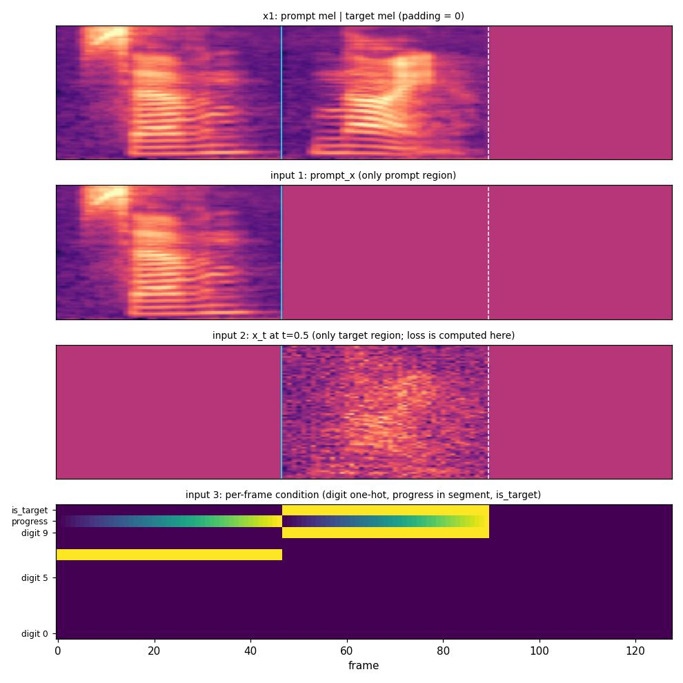

上から、つないだ正解 Mel、入力1(参照 Mel)、入力2(t=0.5 の状態)、入力3(フレームごとの条件)。縦線が参照区間と生成区間の境目、破線が padding の始まり。

### 図2：損失の推移 — [fig2_loss.jpg](outputs/stage3_audiomnist/fig2_loss.jpg)

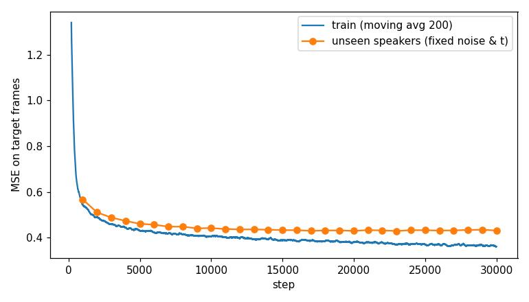

| step | 学習(直近 1000 step の平均) | 新しい話者(ノイズと t を固定した 256 組) |
|---|---|---|
| 5,000 | 0.436 | 0.461 |
| 10,000 | 0.407 | 0.442 |
| 13,000 | 0.397 | 0.436 |
| 20,000 | 0.381 | 0.430 |
| 30,000 | 0.364 | 0.432 |

学習の損失は最後まで下がり続けたが、新しい話者での損失は 13,000 step あたりから 0.43 前後で横ばいになった。

### 数字と話者の評価

| | 数字の正解率 | 話者の当て率 | 類似度(本人 / 他人) |
|---|---|---|---|
| 新しい話者：実データ(Griffin-Lim) | 83.3% | **48.5%** | 0.808 / 0.686 |
| 新しい話者：生成 w=0 | 84.0% | 17.5% | 0.753 / 0.697 |
| 新しい話者：生成 w=0.7 | 92.5% | **20.0%** | 0.750 / 0.691 |
| 新しい話者：生成 w=2 | 93.0% | 25.0% | 0.745 / 0.682 |
| 学習した話者：実データ(Griffin-Lim) | - | **38.0%** | 0.806 / 0.734 |
| 学習した話者：生成 w=0.7 | 84.5% | **40.0%** | 0.790 / 0.720 |

(類似度は、話者ベクトルと「本人の平均ベクトル」「他の 9 人の平均ベクトル」との cosine 類似度の平均。学習した話者の数字の正解率の基準は、分類器の学習に使ったデータなので載せていない)

- **数字は言えている**。w=0 で実データと同じ程度(84.0%)、CFG を強めると実データより分類器に当てられやすくなる(段階2と同じく、条件らしさが強調される)。
- **学習した話者の声は再現できている**。生成の当て率 40.0% は実データの基準 38.0% と同じ水準。
  (学習した 10 人は実データでも当て率が低く、他人との類似度が 0.734 と高い。もともと声が似た人が多いと考えられるので、当て率は新しい話者と直接比べず、それぞれの基準と比べる)
- **新しい話者の声は写せていない**。生成の当て率は 17.5〜25.0% で、偶然(10%)よりは上だが基準(48.5%)の半分以下。
  w を上げると当て率は少し上がる(17.5% → 25.0%)が、本人との類似度は上がっておらず、他人との類似度が下がった分だけ。

### 図3：新しい話者の生成例 — [fig3_unseen_examples.jpg](outputs/stage3_audiomnist/fig3_unseen_examples.jpg)

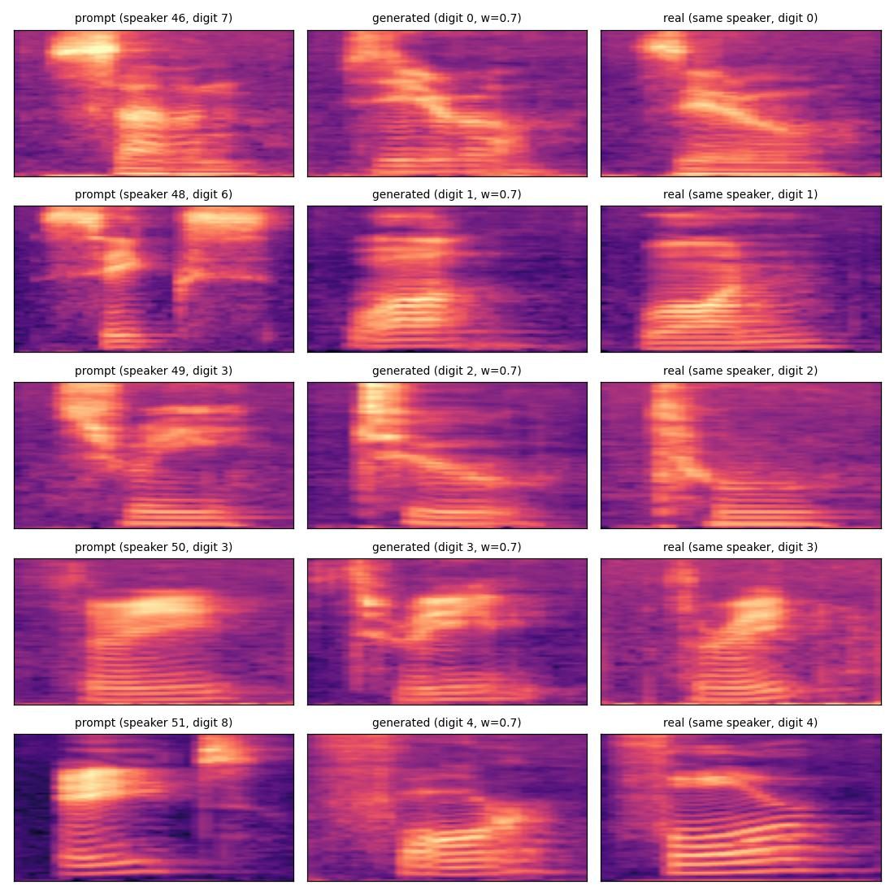

新しい話者 5 人について、左から参照 Mel、生成した Mel(w=0.7)、同じ話者が同じ数字を読んだ実データの Mel。

### 図4：参照の話者だけを入れ替える — [fig4_speaker_swap.jpg](outputs/stage3_audiomnist/fig4_speaker_swap.jpg)

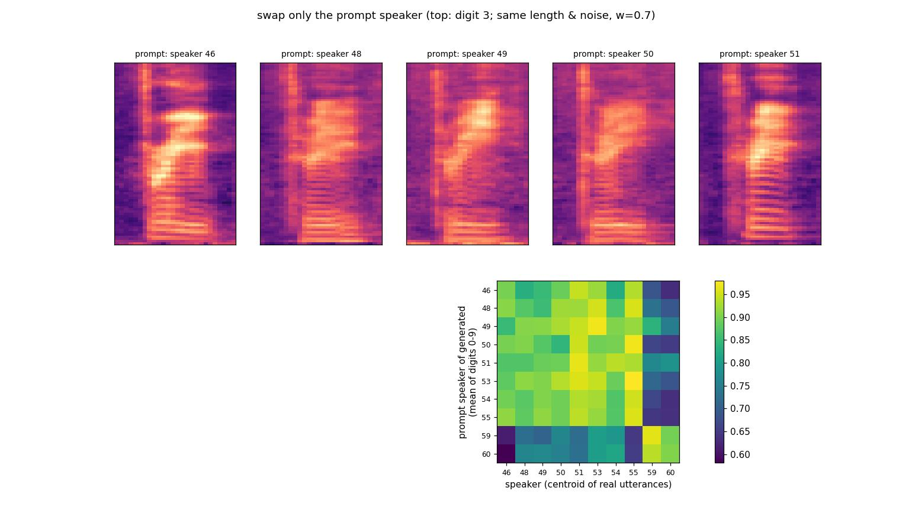

生成する数字・長さ・初期ノイズを共通にして、参照の話者だけを新しい話者 10 人に入れ替えた(w=0.7)。
1 発話の話者ベクトルはばらつきが大きいので、参照の話者ごとに数字 0〜9 の 10 発話を生成し、その平均ベクトルで比べた。
上段は数字 3 の生成 Mel、下段は「参照の話者(行)」と「話者の平均ベクトル(列)」の cosine 類似度。

- 本人の列が一番高くなったのは 10 人中 3 人(51, 55, 59)。類似度の平均は本人 0.913、他人 0.839。
- 男性の参照 8 人分は、すべて男性(51, 53, 55)に一番近いと判定された。女性の参照 2 人分(59, 60)は、どちらも女性の 59 に判定された。
  **性別のような大まかな声の特徴は写せていて、個人の声までは写せていない** 可能性がある(ただし女性は 2 人だけなので、根拠としては弱い)。

### 解釈

このモデルは、参照 Mel を「学習で覚えた話者の誰に近いか」の手がかりとして使い、覚えた声を出している状態で、
**聞いたことのない声を参照から写し取る力(ゼロショットの声のクローン)はまだ弱い**。
新しい話者での損失が早くに横ばいになったこととも合う。

原因の候補は、学習した話者が 50 人しかいないこと(IndexTTS のようなモデルは桁違いに多くの話者で学習する)。
ただし、話者数を変えた比較はしていないので、まだ確かめていない。

## 5. 試聴用の音声 — `outputs/stage3_audiomnist/audio/`

一覧と内容は `audio/samples.csv`(参照の話者番号・性別・参照の数字・生成した数字・w・種類)。

| ファイル | 内容 |
|---|---|
| `{unseen,seen}_ref-spk{話者}_digit{X}_0prompt-digit{Y}.wav` | 参照として与えた実際の録音(数字 Y) |
| `..._1generated_w{w}.wav` | 生成した数字 X(新しい話者は w = 0 / 0.7 / 2、学習した話者は w = 0.7) |
| `..._2real.wav` | 同じ話者が数字 X を読んだ実際の録音 |
| `..._3real_griffinlim.wav` | その録音を Mel にしてから Griffin-Lim で戻したもの(音質の基準) |
| `swap_ref-spk{話者}_0prompt-digit{Y}.wav` / `..._1generated_digit3_w0.7.wav` | 図4 の参照と、その参照で生成した数字 3 |

聞くときの観点:

1. `_1generated` が数字 X と読んでいるか
2. その声が `_0prompt` の人と同じに聞こえるか。音質の悪さは `_3real_griffinlim` と比べて差し引く
3. `seen_` と `unseen_` で、2 の聞こえ方に差があるか(上の結果からは、`seen_` は本人らしく、`unseen_` は別人っぽく聞こえるものが多いはず)
4. `swap_` の 10 人分を並べて、参照の話者を変えたときに声がどれくらい変わるか

## 6. IndexTTS2.5 の s2mel との対応

| 項目 | 段階3 | IndexTTS2.5 s2mel |
|---|---|---|
| 生成対象 | log-Mel 80 bin、16kHz | Mel(参照区間 + 生成区間) |
| 参照の渡し方 | 前半に置き、状態は 0、別入力 `prompt_x` で渡す | 同じ([flow.py](../survey/IndexTTS2.5/models/s2mel/flow.py) の `prompt_x`) |
| 損失の範囲 | 生成区間だけ | 同じ(参照区間を除く) |
| 何を言うかの条件 | 数字 + 区間内の進み具合 | semantic 条件 `mu` |
| 話者ベクトル | なし | `style`(CAM++、192 次元) |
| 速度を出す NN | Transformer エンコーダ(時刻は入力に足す) | DiT |
| CFG の条件なし | 参照・条件を全部 0 | 参照・semantic・話者を 0 |
| Mel → 波形 | Griffin-Lim | BigVGAN(NN ボコーダ) |

## 7. 自分で試すと理解が深まること

- 学習に使う話者を 25 人などに減らして、新しい話者の当て率がさらに下がるか見る(話者数が原因かどうかの確認)。
- 参照を 2 発話つないで長くし、新しい話者の当て率が上がるか見る。
- WavLM や CAM++ の話者ベクトルを条件に足し(IndexTTS の `style` に当たる)、新しい話者の当て率がどう変わるか見る。

---

# 付録

## A. Flow Matching の核心:ペアごとの単純な速度から、平均の速度場が学べる

1. **学習の正解は、ペアごとの単純な速度。**
   1組の `(x0, x1)` について、直線の経路 `xt = (1-t)x0 + t x1` の速度は `x1 - x0`。位置 `x` にも時刻 `t` にもよらない定数で、式で直接書ける。
2. **NN の入力は `xt` と `t` だけで、`x0`・`x1` は渡さない。**
   同じ `(x, t)` を通るペアはたくさんあり、正解の速度もそれぞれ違う。二乗誤差を最小にする出力は正解の条件付き期待値
   `u(x, t) = E[x1 - x0 | xt = x, t]`
   つまり「その位置・時刻を通る全ペアの速度の平均」になる。1本1本の直線の速度は定数でも、どのペアがその点を通るかが `x` と `t` で変わるので、平均は `x` と `t` に依存する速度場になる。
3. **その平均の速度場で、ちゃんと分布が運ばれる。**
   各時刻での点の分布が、学習で作った `xt` の分布(t=1 ではデータ分布)と一致することが示されている(Lipman et al. 2023)。
   同じ論文で、平均の速度場 `u` を直接回帰する損失(計算できない)と、ペアごとの速度を回帰する損失(計算できる)は勾配が等しいことも示されていて、だから計算できるほうで学習すればよい。

段階1・2で見た次の現象は、どれも「平均」であることの表れ。

- 損失が 0 にならない(同じ入力に複数の正解があり、平均しか出せない)。
- 1 step の生成がデータの平均に潰れる(`t=0` の最適な速度が `E[x1] - x0`)。

補足:正解の速度が `t` によらない定数になるのは、直線で補間しているから。補間の経路を変えると(例:拡散モデルの経路)正解は `t` に依存する。
本質は「定数であること」ではなく、「ペアごとの正解が式で書けて、それを回帰すると平均として欲しい速度場が出てくること」。

## B. 拡散モデルとの比較

結論:ノイズの分布をガウス分布にしている限り、両者はほぼ同じもの。違いは「補間の経路」「NN に予測させる量」「損失の時刻ごとの重み」という設計の選び方。
本質的に広がっているのは、Flow Matching では **始点がガウスノイズでなくてもよく、ペアの組み方も自由に選べる** 点。

### 共通している部分

どちらも

1. データ `x1` とノイズ `x0` を混ぜた点 `xt = a(t)·x1 + b(t)·x0` を作り、
2. ペアごとに式で書ける正解を `xt` と `t` だけから回帰し、
3. 結果としてペアについての平均の、時刻に依存する場を学ぶ。

付録 A の仕組みは拡散モデルでも同じ(ノイズ予測の場合、平均として学ばれるのはスコア＝対数密度の勾配)。

### 違う部分

| 項目 | 拡散モデル(DDPM など) | Flow Matching(このコード) |
|---|---|---|
| 補間の経路 | `√ᾱ_t·x1 + √(1-ᾱ_t)·ε`(係数の二乗和を 1 に保つ) | `t·x1 + (1-t)·x0`(直線) |
| NN の予測対象 | ノイズ `ε` が主流(`x1` 予測、v 予測もある) | 速度 `x1 - x0` |
| 損失の重み | 時刻ごとの重みとノイズスケジュールが設計の中心 | `t` を一様に取るだけ(これも重みの選び方の一つ) |
| 理論の出発点 | データにノイズを加えていく確率過程(SDE)とその逆過程 | 決定的な流れ(ODE)を直接定義する |
| 生成 | SDE で確率的に、または ODE(DDIM、probability flow)で決定的に | ODE で決定的に |
| 始点の分布 | ガウスノイズが前提 | 何でもよい(別のデータ分布でもよい) |
| ペアの組み方 | 独立(ランダム) | 独立が基本。最適輸送で近いもの同士を組む(OT-CFM)、学習した流れで組み直す(Rectified Flow)なども可能 |

- **予測対象は1次式で互いに変換できる。** `xt` が分かっていれば、ノイズ予測・`x1` 予測・速度予測のどれか1つから残りが求まる。なので「速度を予測するかノイズを予測するか」は本質的な違いではなく、損失の重み付けが変わるだけ。
- **経路の違いも、時間の取り方を変えれば対応がつく。** Lipman et al. 2023 では、拡散モデルの経路は Flow Matching が扱う「ガウス分布の条件付き経路」の特殊例として含まれる、と整理されている。
  Gao et al. 2024 の解説 "Diffusion Meets Flow Matching: Two Sides of the Same Coin" も、ガウスノイズを使う場合は同じ枠組みの別の設定にすぎないと示している。

### 実用上の差

- **コードが単純。** ノイズスケジュール(β_t や ᾱ_t の表)が要らず、学習は段階1の数行で済む。
- **少ないステップで生成しやすい。** 直線の経路は拡散モデルの経路より曲がりが小さい傾向がある。
  ただし直線なのはペアごとの経路だけで、平均として学ばれる軌跡は曲がる(段階1では、軌跡の長さが直線距離の 1.7 倍)。
  少ないステップを本気で狙うなら、Rectified Flow や OT-CFM のようにペアの組み方を工夫する必要がある。
- **始点を自由に選べる**のが理論として本当に広がった部分。例えば音声変換で「元の声の Mel」から「目標の声の Mel」へ直接流す、といった設計が同じ枠組みで書ける。
